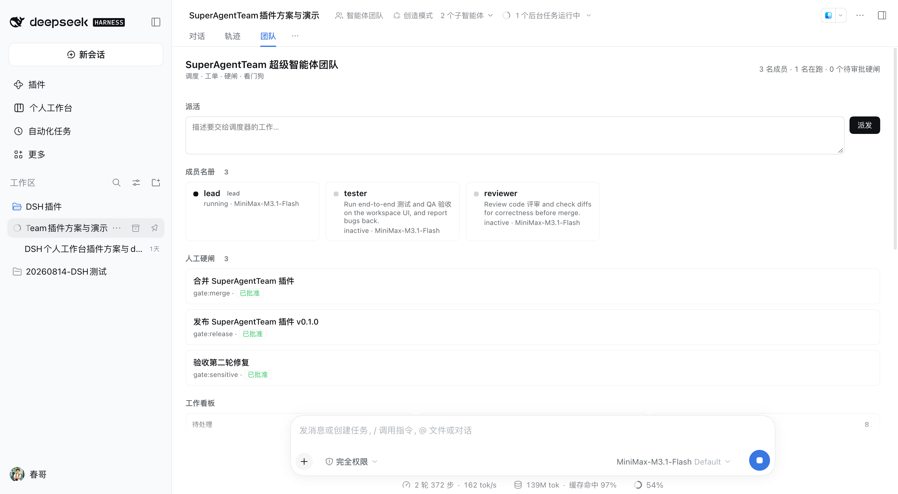

# SuperAgentTeam 超级智能体团队

**调度 · 工单 · 硬闸 · 看门狗**

给 DeepSeek Harness 的 Agent Teams 补上「**会自己派活，而且有人能拍板**」这两层。



---

## 产品介绍

### 它解决什么问题

在 Harness 里用 Agent Teams，多个智能体已经能分工干活了。但还缺两层：

| 缺口 | 现状 | 后果 |
|---|---|---|
| **谁来决定活派给谁** | 只能人当项目经理，手动转述需求、指派队友 | 人成了瓶颈，团队规模一大就转不动 |
| **关键决策谁能拍板** | 合并、发版、敏感操作，模型自己就能往下走 | 闸门形同虚设，审批变成表演 |

SuperAgentTeam 补的就是这两层：

1. **Router（调度器）** —— 需求进来，规则引擎直接判定该派给谁，并落成看板工单，派活闭环自动跑起来。
2. **人工硬闸（Gate）** —— 合并、发版这类事必须停下来等人点头，**模型无法自己批准**。

### 一句话设计取向

> **能被工程确定性完成的分流，绝不交给模型临场判断。**

Router 的规则层是确定性的、零模型调用的。它放不下的时候**不猜**——不硬派给一个不相干的队友，而是创建一张「无主工单」升级给 Lead，因为 Lead 本身就是模型，而且手握全局上下文。

对比几种常见做法：

| 做法 | 问题 |
|---|---|
| 只用提示词让 Lead 指挥多个 Agent | 协作行为不稳定：同一句提示词下，模型可能连续多轮都不派活 |
| 让模型自己判断该派给谁 | 同一个请求两次派给不同队友，无法复现、无法审计 |
| 让模型自己批准闸门 | 闸门失效，审批沦为形式 |

SuperAgentTeam 把派活与审批都落成代码和状态机，**行为可复现、结论可追溯**。

---

## 核心功能

### 1. Router：两级过滤

**① 规则层（确定性、零模型调用）**

| 规则 | 判定 | 分数 |
|---|---|---|
| 显式点名 | 请求文本里出现队友名（拉丁名按**整词**匹配且长度 ≥3） | 1000（直接命中） |
| 技能亲和 | 请求与队友描述共享**技能标签**（test / review / ui / docs / build / release / data / ops / perf / fix，中英双语词表） | 100 + 10 × 标签数 |
| 关键词命中 | 队友描述的分词（英文词 + 中文二元组）出现在请求里 ≥2 次 | 10 + 命中数 |

**② 判定层（模型）**：规则放不下时，创建一张 unowned 工单升级给 Lead（`team_intake` 返回 `escalated: true`），由 Lead 决定归属。

几个实现细节：

- **词边界不是洁癖。** 裸子串匹配下 “b**ui**ld” 含 “ui”，一条**构建类**请求会被判成 UI 亲和派给测试同学——这种误派是稳定复现的。拉丁词条一律按**词边界前缀**匹配（`\bbuild\w*`），只有歧义词（ci / ui / ux / qa / ops / perf / data / database / lint / css / e2e）保持精确匹配。
- **短名不参与自动点名。** 长度 ≤2 的名字（`qa`、`ui` 之类）太容易被无关文本命中，这类队友用 `target` 参数显式指定。
- **Router 只在队友之间选**，Lead 不参与规则路由；已经 `failed` 的成员会被跳过。

### 2. Work Item：工单即真相

路由命中即建工单。Router 建出来的是一张**无主 pending 工单**——owner 要等队友自己 claim，依赖关系由 `set_dependencies` 补上；工单表本身支持 **owner**、**blockedBy 依赖**、**advisory write scopes**、**CAS 乐观锁**。

依赖 DAG 因此形成「带硬闸的交付闭环」：依赖未全部完成的工单**不可认领**（`ready: false`）。

### 3. 人工硬闸

- 一个闸门 = **一张主题以 `[GATE:<kind>]` 开头的工单**。
- 需要该闸门的工单把闸门 id 填进 `blockedBy` → 原生 DAG **拒绝释放**它。
- **模型不能自己批准**：工具守卫是单调同步守卫，命中 `team_task_update` 且目标是闸门工单时直接返回拒绝理由，守卫之后的任何监听者都无法翻案。
- **只有人能批**：`/super-team approve <id>` 与面板按钮直接调用任务服务，**不经过工具管线**，因此不被守卫拦截。
- **批准与否都是终态**：批准 = 完成；否决 = 完成 + 主题标 `REJECTED`——人说了「不」，工单该被重新规划，而不是永远等下去。
- 判定结论**持久化在工单上**，插件重载 / HMR 后闸门区块、按钮与结论都还在。

### 4. 看门狗（Watchdog）

每 60 秒自动扫描，模型也可随时主动触发。捕获三类异常：

| 类型 | 含义 |
|---|---|
| `member-failed` | 队友创建失败 |
| `stalled` | 工单进行中，但 owner 已 `inactive` / `failed` |
| `unclaimed` | 工单待处理且可认领，却无人认领（闸门工单除外） |

告警列表**每次扫描重建**而不是追加：同一个异常不会在账本里堆成几十份重复条目，恢复了的异常自动消失。

### 5. 团队面板（Control Deck）

注册为会话内的一个 View 标签页——Web GUI 对话区的「**团队**」页：

- **派活输入框**：把手头的事直接丢给 Router
- **成员名册**：实时状态、模型、职责描述
- **工作看板**：待处理 / 进行中 / 已完成三列
- **人工硬闸**：待批闸门 + 批准 / 否决按钮
- **调度流水**：每次路由决策的时间、主题、目标与理由（升级给 Lead 的会标成「已升级给 Lead 判定」）
- **看门狗告警**

面板**写入** Host 的唯一通道是 `ctx.remote.commands.execute` → `/super-team`；**读取**以 Host 快照为主、Session 的 `agentTeam` 投影作兜底（字段名不同，兜底时做映射）。

---

## 优势

| 维度 | SuperAgentTeam 的做法 |
|---|---|
| **派活确定性** | 规则层零模型调用，同一请求永远派给同一人，可复现、可审计 |
| **不乱猜** | 放不下的请求升级给 Lead，而不是硬派给不相干的队友 |
| **闸门有牙** | 单调守卫 + 看板 DAG 双重约束：模型改不动闸门，只能人批 |
| **零额外持久化** | 复用 `ctx.agentTeams` 原生任务表；会话日志即真相，**看板 / 名册 / 闸门结论**重载不丢 |
| **刷新即最新** | 面板每 8 秒轮询一次 Host 快照，浏览器端直接读 Host 投影，不另建存储 |
| **一套实现，两个入口** | 模型走工具，人走 `/super-team` 命令与面板按钮，共用同一套 Host 方法 |
| **不新增依赖** | 纯插件实现，不引入裸依赖，本地 link 安装即可 |

还有一点值得单说：**这套插件用自己派活来评审自己。**

第一轮跑通后，插件自己派了一个评审任务：

```
team_intake({ subject: "评审本次改动", description: "请 review 这次改动的 diff" })
→ routed to reviewer · skill affinity on review · task-3
```

reviewer 队友读懂了 DSH 运行时实现（从 `app.asar` 里提取真实代码逐条核对），交回一份报告：**1 个阻断、3 个高危、6 个中危、6 个低危**。第一轮修掉其中 13 项（阻断 + 3 高危 + 6 中危 + L1~L3 低危）；第二轮交叉验证又挖出 **2 阻断 + 2 高危**——这一轮的问题要真机跑起来才会暴露。

这正是这套架构要证明的东西：**AI 派活 → AI 执行 → 人类只看结果**。主要修复都有对应的回归测试兜住——上面三个测试套件就是它们的产物；看门狗去重、通知失败留痕、显式 `target` 的边界等少数项目前只有实现、还没有断言。评审报告与完整设计文档保留在作者本地工作区，不随本仓库发布。

---

## 用法

### 安装

依赖官方 Agent Teams 底座。`plugin_manager` 是**模型工具**而非 shell 命令，安装动作由它完成（不要自己改 profile 目录、也不要手写 `cordis.patch.yml`）。

先取到代码：

```bash
git clone https://github.com/windangle/SAT.git
```

再让模型发起两次工具调用：

```text
# ① 启用 Agent Teams 底座（target 填 bundle 包名）
plugin_manager({ action: "set_bundle",
                 target: "@deepseek-ai/dsh-experimental-agent-team-profile",
                 enabled: true })

# ② 安装本插件（target 填 bundle 目录的绝对路径，或相对当前目录的路径）
plugin_manager({ action: "install_bundle",
                 target: "<SAT 的绝对路径>",
                 enabled: true })
```

仓库根目录就是 bundle 根（`package.json`、`cordis.patch.yml` 都在根上），`git clone` 之后直接指向那个目录即可；本地目录安装会落成 `link:` 依赖。

> DSH 默认 profile 未开启 Agent Teams。未开启时本插件保持 `pending` 而非报错。
> `plugin_manager` 的每次调用都需要审批——只在该动作的结果会影响下一步时才调它。
> 同一个路径重复安装会报 `already-installed`，先 `remove_bundle` 再装。

### 给模型：四个工具

| 工具 | 用途 | 参数 |
|---|---|---|
| `team_intake` | 把一条工作请求交给 Router 判定归属 | `subject`、`description`（必填）；`target`（跳过规则过滤直接指定队友）、`write_scopes`（本次预计修改的路径前缀） |
| `team_status` | 名册、看板、待批闸门、调度流水 | 无 |
| `team_gate_request` | 在合并 / 发版 / 敏感操作前举一道人工硬闸 | `kind`、`subject`、`detail` |
| `team_watchdog` | 主动查失败成员、停滞工单和无人认领的活 | 无 |

**派活是幂等的**：同名、待处理且无人认领的工单不会被重复创建（返回 `deduplicated: true`），所以误点两次「派发」不会建出两张一样的单。但已被认领或已完成的同名工单**不拦截**——修完 bug 后重跑同一项检查是正当工作。

### 给人：控制面

```
/super-team state                  # 看整块看板（JSON）
/super-team intake <需求>          # 手动丢给 Router
/super-team approve task-1         # 批准闸门 —— 模型走不通这条路
/super-team reject task-1          # 否决闸门
/super-team delete task-1          # 删除工单
/super-team clean-scopes           # 清理旧版本闸门遗留的写范围标记
```

或者直接在会话「团队」标签页里点按钮。

> 仍被其他工单 `blockedBy` 依赖的工单不能删——Host 会拒绝，先把依赖解开。

### 一个完整闭环

```
① 派活     team_intake({ subject: "评审本次改动", description: "请 review 这次 diff" })
           → routed to reviewer · skill affinity on review · task-3

② 执行     reviewer 认领 task-3 → 干活 → complete

③ 举闸     team_gate_request({ kind: "merge", subject: "合并 SuperAgentTeam", detail: "..." })
           → 面板出现待批闸门

④ 拍板     人在面板点「批准」 → 闸门 completed → 依赖它的工单自动放行
```

---

## 测试

```bash
node test/host.test.mjs      # 规则层与闸门语义的单元测试（24 项断言）
node test/contract.test.mjs  # Host 任务状态机契约测试（24 项断言）
node test/render.test.mjs    # 面板渲染路径的离线测试（25 项断言）
```

共 **73 项断言**，全部通过。

- **`render.test.mjs`** 用一个迷你 React 渲染器加载**真实的 `client.js`**，喂给它一组贴近真实的固定夹具（Host 快照 + Session 投影），再断言渲染结果：页面里不出现字面量 `undefined`、已认领工单显示正确负责人、点「Dispatch」真的打到 `/super-team intake` 且带的是**真实 AbortSignal**、点「Allow」真的打到 `/super-team approve`。
- **`contract.test.mjs`** 照抄 Host 的任务状态机规则做了一个假的 `agentTeams`，然后用**真实的插件代码**跑 `requestGate → decideGate(approve/reject)` 全链路，并断言守卫、判定标记与遗留范围清理。它是有牙的：把 `decideGate` 改回旧的「只 complete」写法，它立刻报 7 条失败。

---

## 已知边界

诚实说明：

- **调度流水与看门狗告警存在插件内存里**，重载即清空（看板、名册与闸门结论不受影响）。
- 闸门的「已批准 / 已否决」结论**持久化在工单上**，插件重载不丢。
- 所有队友**共享同一个工作目录**（DSH Agent Teams 的既有约束），本插件未引入 worktree 隔离。
- 面板每 8 秒轮询一次整块看板，当前规模可接受，后续可改为订阅投影。
- 插件**暂不声明 `Config`**（取舍）：可调项暂用常量，后续可随依赖一起补。

---

## License

MIT —— 见 [LICENSE](LICENSE)。

完整设计文档（中文，含素材解读、能力映射、架构图、逐轮自评审修复记录）保留在作者的本地工作区，不随本仓库发布。
