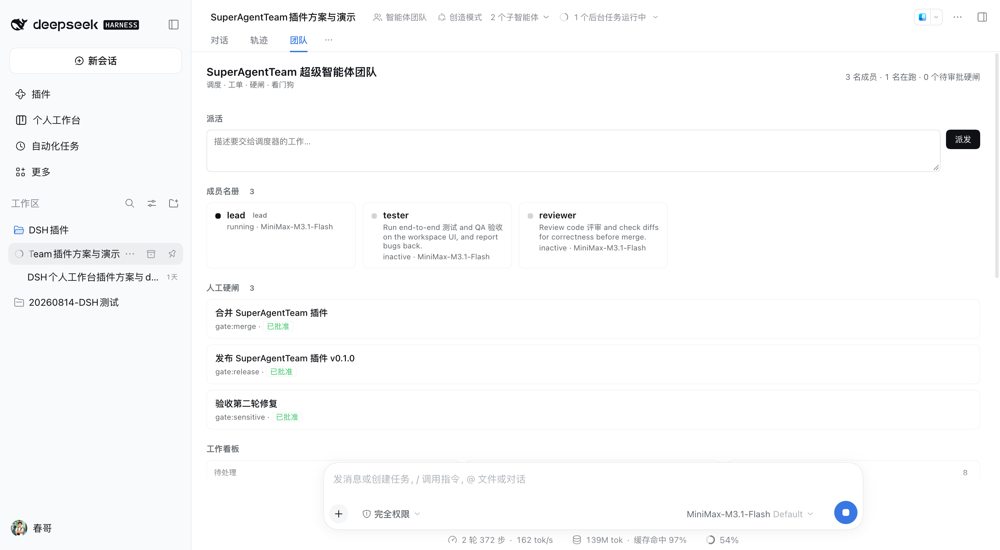

# SuperAgentTeam 超级智能体团队

**调度 · 工单 · 硬闸 · 看门狗**

给 DeepSeek Harness 的 Agent Teams 补上「**会自己派活，而且有人能拍板**」这两层。



---

## 产品介绍

### 它解决什么问题

在 Harness 里用 Agent Teams，多个智能体已经能分工干活了。但还缺两层：

| 缺口 | 现状 | 后果 |
|---|---|---|
| **谁来决定活派给谁** | 只能人当项目经理，手动转述需求、指派队友 | 人成了瓶颈，团队规模一大就转不动 |
| **关键决策谁能拍板** | 合并、发版、敏感操作，模型自己就能往下走 | 闸门形同虚设，审批变成表演 |

SuperAgentTeam 补的就是这两层：

1. **Router（调度器）** —— 需求进来，规则引擎直接判定该派给谁，并落成看板工单，派活闭环自动跑起来。
2. **人工硬闸（Gate）** —— 合并、发版这类事必须停下来等人点头，**模型无法自己批准**。

### 一句话设计取向

> **能被工程确定性完成的分流，绝不交给模型临场判断。**

Router 的规则层是确定性的、零模型调用的。它放不下的时候**不猜**——不硬派给一个不相干的队友，而是创建一张「无主工单」升级给 Lead，因为 Lead 本身就是模型，而且手握全局上下文。

对比几种常见做法：

| 做法 | 问题 |
|---|---|
| 只用提示词让 Lead 指挥多个 Agent | 协作行为不稳定：同一句提示词下，模型可能连续多轮都不派活 |
| 让模型自己判断该派给谁 | 同一个请求两次派给不同队友，无法复现、无法审计 |
| 让模型自己批准闸门 | 闸门失效，审批沦为形式 |

SuperAgentTeam 把派活与审批都落成代码和状态机，**行为可复现、结论可追溯**。

---

## 核心功能

### 1. Router：两级过滤

**① 规则层（确定性、零模型调用）**

| 规则 | 判定 | 分数 |
|---|---|---|
| 显式点名 | 请求文本里出现队友名（拉丁名按**整词**匹配且长度 ≥3） | 1000（直接命中） |
| 技能亲和 | 请求与队友描述共享**技能标签**（test / review / ui / docs / build / release / data / ops / perf / fix，中英双语词表） | 100 + 10 × 标签数 |
| 关键词命中 | 队友描述的分词（英文词 + 中文二元组）出现在请求里 ≥2 次 | 10 + 命中数 |

**② 判定层（模型）**：规则放不下时，创建一张 unowned 工单升级给 Lead（`team_intake` 返回 `escalated: true`），由 Lead 决定归属。

几个实现细节：

- **词边界不是洁癖。** 裸子串匹配下 “b**ui**ld” 含 “ui”，一条**构建类**请求会被判成 UI 亲和派给测试同学——这种误派是稳定复现的。拉丁词条一律按**词边界前缀**匹配（`\bbuild\w*`），只有歧义词（ci / ui / ux / qa / ops / perf / data / database / lint / css / e2e）保持精确匹配。
- **短名不参与自动点名。** 长度 ≤2 的名字（`qa`、`ui` 之类）太容易被无关文本命中，这类队友用 `target` 参数显式指定。
- **Router 只在队友之间选**，Lead 不参与规则路由；已经 `failed` 的成员会被跳过。

### 2. Work Item：工单即真相

路由命中即建工单。Router 建出来的是一张**无主 pending 工单**——owner 要等队友自己 claim，依赖关系由 `set_dependencies` 补上；工单表本身支持 **owner**、**blockedBy 依赖**、**advisory write scopes**、**CAS 乐观锁**。

依赖 DAG 因此形成「带硬闸的交付闭环」：依赖未全部完成的工单**不可认领**（`ready: false`）。

### 3. 工作包（Work Package）：把一次交办拆成几块

Lead 收到一个复杂请求时，可以调用 `team_plan` 把它**拆成若干子工单**，并用一张「包工单」把它们绑在一起：

```
team_plan({
  goal: "交付 v0.2：工作包能力",
  completion: "all",              // 完成标准由 Lead 按实际情况选
  items: [
    { subject: "补齐工作包的模型侧测试", description: "…" },
    { subject: "面板侧：工作包区块与人工确认按钮", description: "…" },
    { subject: "文档侧：更新方案与 README", description: "…" },
  ],
})
```

每个子项**各自走 Router**（独立路由到合适的队友），包工单本身也是一张工单，于是**「我交办的一件事」和「它被拆成的几块」在看板上是连着的**。

**完成标准由 Lead 按包指定**，因为合适的规则取决于工作性质：

| 策略 | 包什么时候算完成 | 谁来关 |
|---|---|---|
| `all` | 全部子项都落地 | 插件自动结算 |
| `any` | 有一条可接受的路走通即可 | 插件自动结算 |
| `manual` | 子项都做完了，但**由人拍板**收口 | **只能人关**——模型改不动它（守卫同硬闸） |

**关联怎么存**：包工单的描述里带一段紧凑标记（`@@sat-package completion=… children=…`），**整棵树就在原生任务表里**。没有额外存储、没有独立表——插件重载后直接从看板重建，重载不丢。

### 4. 人工硬闸

- 一个闸门 = **一张主题以 `[GATE:<kind>]` 开头的工单**。
- 需要该闸门的工单把闸门 id 填进 `blockedBy` → 原生 DAG **拒绝释放**它。
- **模型不能自己批准**：工具守卫是单调同步守卫，命中 `team_task_update` 且目标是闸门工单时直接返回拒绝理由，守卫之后的任何监听者都无法翻案。
- **只有人能批**：`/super-team approve <id>` 与面板按钮直接调用任务服务，**不经过工具管线**，因此不被守卫拦截。
- **批准与否都是终态**：批准 = 完成；否决 = 完成 + 主题标 `REJECTED`——人说了「不」，工单该被重新规划，而不是永远等下去。
- 判定结论**持久化在工单上**，插件重载 / HMR 后闸门区块、按钮与结论都还在。
- **审批卡片**：举闸门时 `team_gate_request` 会同时走 `ctx.approval` 向人弹一张审批卡（对话里、手机上都能批）。**它不阻塞举闸的 turn**——卡片回答到达后异步去结算看板上同一张闸门；面板的「批准 / 否决」按钮是通向同一张工单的第二条路，谁先到谁生效，晚到的那个是安全的空操作。没人应答 / 取消时闸门保持 `pending`，「没人能问」绝不读成「已批准」。开关 `approvalGates`。

### 5. 看门狗（Watchdog）

每 60 秒自动扫描，模型也可随时主动触发。捕获三类异常：

| 类型 | 含义 |
|---|---|
| `member-failed` | 队友创建失败 |
| `stalled` | 工单进行中，但 owner 已 `inactive` / `failed` |
| `unclaimed` | 工单待处理且可认领，却无人认领（闸门工单除外） |

告警列表**每次扫描重建**而不是追加：同一个异常不会在账本里堆成几十份重复条目，恢复了的异常自动消失。

**停滞不只报告，还会回收**：Host 原生约束是「队友掉线 / 中断 / 失败都不会释放工单 owner」，所以队友挂了活就永远卡在那儿。看门狗现在会自己把这种工单 `release` 掉——`failed` 的 owner 立刻释放，`inactive` 的 owner 超过 `stallAfterMs`（默认 10 分钟）才释放，避免抢走一个只是正在思考的队友的活。这个开关是 `autoReleaseStalled`。

### 6. 团队面板（Control Deck）

注册为会话内的一个 View 标签页——Web GUI 对话区的「**团队**」页：

- **派活输入框**：把手头的事直接丢给 Router
- **成员名册**：实时状态、模型、职责描述
- **工作包**：包目标、完成策略徽标、`x/y 已完成` 进度、嵌套的子项；`manual` 的包带「人工确认并关闭」按钮
- **工作看板**：待处理 / 进行中 / 已完成三列（包与其子项在上面，看板只放独立工单）
- **人工硬闸**：待批闸门 + 批准 / 否决按钮
- **调度流水**：每次路由决策的时间、主题、目标与理由（升级给 Lead 的会标成「已升级给 Lead 判定」）
- **最近完成**：刚落地的工单、负责人与完成时间（时间线视角，与看板「已完成」列是同一批工单的两种看法）
- **看门狗告警**

**轮询是条件触发的**：名册与工单本来就从 `agentTeam` 投影实时到达，只有硬闸 / 工作包 / 流水 / 完成记录才需要问 Host。看板没动、也没有在跑的活或待批闸门时，退避到 30 秒；一动就立刻拉一次并回到 8 秒。

面板**写入** Host 的唯一通道是 `ctx.remote.commands.execute` → `/super-team`；**读取**以 Host 快照为主、Session 的 `agentTeam` 投影作兜底（字段名不同，兜底时做映射）。

### 7. Agent 公司层（组织治理）

> 侧栏入口叫 **「Agent公司」**（在工作区列表上方），不是「公司」。
>
> **面板首屏信息架构**（按董事长反馈重排）：四个数字概览 → **需要我决策** → **我的项目**（可筛选，卡片含目标/状态/PM/进展/工单/成果/CEA 终审/董事长验收/项目任务定位）→ 给 CEA 派任务。组织结构、工作负载、CEA 岗位说明书、治理章程、PM 知识、台账、审计流水全部**默认折叠在一个次要区**，一键展开。

上面 1~6 是**执行层**（一个会话里的团队）。公司层是压在上面的**组织层**——管的是「一家公司」而不是「一堆活」：

- **董事长（人）** 只对接 **CEA 首席执行 Agent**（唯一 Router）。CEA 理解并确认需求、设计岗位 JD、按任务派到岗位、对最终产出审核负责，再交付董事长验收。
- **岗位（一类）**：有 JD、职责边界、验收标准；状态 `proposed / active`。每个岗位有一个 **Leader**——活少自己干，活多临时招员工（`ctx.subagents.startActivation`）；Leader 与普通员工的差别是**识别并积累岗位技能 / 能力**。
- **PM**：一个 PM 负责一类项目，沉淀该类**业务知识 / 经验**与**每个项目的情况记忆**。
- **CEA 代拍板有边界**：白名单内的低风险决策可自决并记审计；**最终成果必须董事长审核通过才算完成**。模型工具集里没有 `approve` / `reject`——拍板走 `/company` 命令与面板，模型拿不到这条通路。
- **组织状态是 profile 级**（`ctx.storage` 的 `super_agent_company` KV），因为 `agentTeams` 名册绑在单个 Lead 会话日志里，跨不了工作区。执行状态仍在会话级团队里 —— **组织状态与执行状态分离**。

**公司总览**（侧栏「公司」入口，在工作区列表上方）：CEA 派任务框、董事长待办（需求确认 / 批准 JD / 验收成果）、组织架构（岗位 + Leader + 能力档案）、PM 与项目组合、公司动态。
**项目视图**（每个会话的「项目视图」页）：按当前 `workspaceId` / 工作区标题过滤，只看这个项目的目标、工单、CEA 终审、董事长验收状态。

**CEA 岗位说明书**：`CEA_ROLE` 是唯一真相——既写进组织状态（面板里的「CEA · 岗位说明书」区块），又由 `ceaPersona()` 生成注入模型的 persona，两处不会漂移。含身份、使命、**9 条能力**（需求澄清、项目/任务定位、拆解编排、组织设计、按能力派工、风险跟踪、终审、向上沟通、组织记忆）、**6 条硬要求**、**6 条工作习惯**、代拍板权白名单、5 条不可为、验收标准。核心定位：**公司的经营者，不是执行者**；董事长唯一对接的 Router。

**预设组织架构**（调研精简但运作完善的中小型互联网公司后落地，`PRESET_ORG`）：**5 部门 / 14 岗位 / 3 PM**。
产品与设计 · 研发 · 质量与运维 · 数据与增长运营 · 综合管理。每个岗位有完整 JD（使命/职责/技能/边界/验收）与岗位 Leader 能力档案；3 个岗位标 `planned`（**待招虚框**，不冒充在编）。3 位 PM 各管一类项目（工具类/插件类、内容与研究类、运营与增长类），各带该类项目的业务知识与经验。依据：**先列事再列岗**、约 30 人分 3~4 组、必须有一人专职行政财务、层级 ≤ 3、直接下属 ≤ 8、待招用虚线框。

**项目 / 任务定位（一个工作区 = 一个项目，一个会话 = 一个任务）**：CEA 立案时先枚举**真实工作区与会话**，用标题归一化判断「新建 vs 走存量」，把定位写进需求确认决策给你拍板；**确认后才落地**。董事长可改选路由，批准时存量直接绑 id、新建会话尝试真建、全新工作区不在你背后建目录（记 `provisioning`，等你在 GUI 建好后 `bind` 真实 id）。

```
/company state                              # 整家公司的状态（JSON）
/company brief <任务> | [项目] | [任务标题]   # CEA 立案：复述理解 + 项目/任务定位，等你确认才派工
/company route <决策> | <工作区|新:名称> | <会话|新:标题>   # 董事长改选项目/任务
/company bind <项目> | <workspaceId> | <sessionId>          # 董事长绑定真实工作区/会话 id
/company inventory                         # 列出真实工作区与会话
/company hq <workspaceId> | <sessionId>      # 绑定 CEA 总部会话（面板也有「把当前会话设为董事长办公室」按钮）
/company export                             # 导出业务知识/项目记忆/岗位能力到工作区 .agent-company.md
/company position <岗位> | <JD>              # CEA 起草 JD，等你批准才新增岗位
/company dispatch <项目> | <岗位> | <活>      # 派到岗位（不是个人）
/company deliver <项目> | <成果> | [自审]     # CEA 终审后提交你验收
/company approve <决策>                      # 董事长批准（模型没有这个工具）
/company reject <决策> | [理由]              # 董事长驳回
/company reset                              # 重置为演示组织架构
```

给模型的 CEA 侧工具：`company_status` / `company_brief`（可带 `project` / `task_title` 提示）/ `company_position_design` / `company_dispatch` / `company_deliver`（**没有** approve / reject / route / bind——这些是人的）。

> **三条架构决策已按董事长拍板落地**：① 运行模型 **A**（单 CEA 总部会话，模型 B 后续演进）；② CEA 有独立 **「董事长办公室」工作区+会话**（`company.headquarters`）；③ 知识 **KV 存结构 + 工作区纯文本存知识，两者都留**（`/company export`）。三条写进 `COMPANY_CHARTER`（locked，带依据与日期），旧状态读取时自动补齐。
>
> 当前是**纵切 Demo**：组织结构、决策闭环、两级视图、落盘都已跑通并真机验过。Leader 真的自动 spawn 临时员工、PM 自动写知识、跨工作区联邦执行（模型 B）是下一步 —— 落点与契约见本地设计文档 `AgentCompany-方案.md` 第三章（该文档保留在本地工作区，不随仓库发布）。

### 8. 配置与持久化

- **`Config`**：插件现在有真正的配置 schema（Loader 用 `Config['~standard'].validate` 校验，手写 Standard Schema，**不依赖 zod**）。可调项：`keywordThreshold`、`watchdogIntervalMs`、`stallAfterMs`、`autoReleaseStalled`、`approvalGates`、`persistLedger`、`ledgerLimit`。
- **调度流水落盘**：路由决策与完成记录写进 `~/.dsh/storages/super_agent_team_ledger/` 下的可读 JSON，插件重载后自动读回。走的是 `ctx.storage` 的 KV 通道（普通 descriptor，不需要 schema 库）；每个操作**用完即关**，因为后端规定「一个 unit 同时只能有一个 live handle」。
- **团队模板**：`/super-team template [name]` 从工作区 `.team/roster.json`（或 `.team/roster/<name>.json`）读一份名册，一次性把预设成员 spawn 出来。名册是纯文本，团队自己就能改。

---

## 优势

| 维度 | SuperAgentTeam 的做法 |
|---|---|
| **派活确定性** | 规则层零模型调用，同一请求永远派给同一人，可复现、可审计 |
| **不乱猜** | 放不下的请求升级给 Lead，而不是硬派给不相干的队友 |
| **闸门有牙** | 单调守卫 + 看板 DAG 双重约束：模型改不动闸门，只能人批 |
| **零额外持久化** | 复用 `ctx.agentTeams` 原生任务表；会话日志即真相，**看板 / 名册 / 闸门结论**重载不丢 |
| **刷新即最新** | 面板每 8 秒轮询一次 Host 快照，浏览器端直接读 Host 投影，不另建存储 |
| **一套实现，两个入口** | 模型走工具，人走 `/super-team` 命令与面板按钮，共用同一套 Host 方法 |
| **不新增依赖** | 纯插件实现，不引入裸依赖，本地 link 安装即可 |

还有一点值得单说：**这套插件用自己派活来评审自己。**

第一轮跑通后，插件自己派了一个评审任务：

```
team_intake({ subject: "评审本次改动", description: "请 review 这次改动的 diff" })
→ routed to reviewer · skill affinity on review · task-3
```

reviewer 队友读懂了 DSH 运行时实现（从 `app.asar` 里提取真实代码逐条核对），交回一份报告：**1 个阻断、3 个高危、6 个中危、6 个低危**。第一轮修掉其中 13 项（阻断 + 3 高危 + 6 中危 + L1~L3 低危）；第二轮交叉验证又挖出 **2 阻断 + 2 高危**——这一轮的问题要真机跑起来才会暴露。

这正是这套架构要证明的东西：**AI 派活 → AI 执行 → 人类只看结果**。主要修复都有对应的回归测试兜住——上面三个测试套件就是它们的产物；看门狗去重、通知失败留痕、显式 `target` 的边界等少数项目前只有实现、还没有断言。评审报告与完整设计文档保留在作者本地工作区，不随本仓库发布。

---

## 用法

### 安装

依赖官方 Agent Teams 底座。`plugin_manager` 是**模型工具**而非 shell 命令，安装动作由它完成（不要自己改 profile 目录、也不要手写 `cordis.patch.yml`）。

先取到代码（本仓库是插件集合，插件在子目录里）：

```bash
git clone https://github.com/windangle/windangle-dsh-plugins.git
```

再让模型发起两次工具调用：

```text
# ① 启用 Agent Teams 底座（target 填 bundle 包名）
plugin_manager({ action: "set_bundle",
                 target: "@deepseek-ai/dsh-experimental-agent-team-profile",
                 enabled: true })

# ② 安装本插件（target 指向 super-agent-team/ 子目录）
plugin_manager({ action: "install_bundle",
                 target: "<仓库路径>/super-agent-team",
                 enabled: true })
```

本插件位于仓库的 `super-agent-team/` 子目录，`target` 要指向它而不是仓库根；本地目录安装会落成 `link:` 依赖。仓库里还有另一个插件 `personal-workbench/`，两者可同时安装、互不冲突。

> DSH 默认 profile 未开启 Agent Teams。未开启时本插件保持 `pending` 而非报错。
> `plugin_manager` 的每次调用都需要审批——只在该动作的结果会影响下一步时才调它。
> 同一个路径重复安装会报 `already-installed`，先 `remove_bundle` 再装。

### 给模型：执行层五个工具（另有公司层 `company_*`，见第 7 节）

| 工具 | 用途 | 参数 |
|---|---|---|
| `team_intake` | 把一条工作请求交给 Router 判定归属 | `subject`、`description`（必填）；`target`（跳过规则过滤直接指定队友）、`write_scopes`（本次预计修改的路径前缀） |
| `team_plan` | 把一次交办**拆成若干子项**，并用一张包工单把它们绑在一起 | `goal`、`items`（必填）；`completion`（`all` / `any` / `manual`，由 Lead 按实际情况选）、`description` |
| `team_status` | 名册、看板、待批闸门、调度流水 | 无 |
| `team_gate_request` | 在合并 / 发版 / 敏感操作前举一道人工硬闸 | `kind`、`subject`、`detail` |
| `team_watchdog` | 主动查失败成员、停滞工单和无人认领的活 | 无 |

**派活是幂等的**：标题、**目标队友**与说明都相同、且待处理无人认领的工单不会被重复创建（返回 `deduplicated: true`），所以误点两次「派发」不会建出两张一样的单。但已被认领或已完成的同名工单**不拦截**——修完 bug 后重跑同一项检查是正当工作。

去重认的是「同一件事」：**标题 + 目标 + 说明**。只看标题会吞掉拆解出来的另一半；不看目标则会吞掉「同一件事让 tester 和 reviewer 都做一遍」——Lead 明确指派给不同队友时，第二份工单照建不误。

### 给人：控制面

```
/super-team state                       # 看整块看板（JSON）
/super-team intake <需求>               # 手动丢给 Router
/super-team plan <目标> | <子项> | …     # 拆成工作包（可加 all: / any: / manual: 前缀）
/super-team template [name]             # 从 .team/roster.json 物化一支预设团队
/super-team approve task-1              # 批准闸门 —— 模型走不通这条路
/super-team reject task-1               # 否决闸门
/super-team complete task-20            # 人来收口一个 manual 包
/super-team delete task-1               # 删除工单
/super-team clean-scopes                # 清理旧版本闸门遗留的写范围标记
```

或者直接在会话「团队」标签页里点按钮。

> 仍被其他工单 `blockedBy` 依赖的工单不能删——Host 会拒绝，先把依赖解开。

### 一个完整闭环

```
① 派活     team_intake({ subject: "评审本次改动", description: "请 review 这次 diff" })
           → routed to reviewer · skill affinity on review · task-3

② 执行     reviewer 认领 task-3 → 干活 → complete

③ 举闸     team_gate_request({ kind: "merge", subject: "合并 SuperAgentTeam", detail: "..." })
           → 面板出现待批闸门

④ 拍板     人在面板点「批准」 → 闸门 completed → 依赖它的工单自动放行
```

---

## 测试

```bash
node test/host.test.mjs        # 规则层与闸门语义的单元测试
node test/contract.test.mjs    # Host 任务状态机契约测试（闸门 + 工作包全链路）
node test/render.test.mjs      # 面板渲染路径的离线测试
node test/render-ui.test.mjs   # 「最近完成」区块与条件轮询（含可控假时钟）
node test/features.test.mjs    # Config / 持久化 / 停滞回收 / 完成汇总 / 审批 / 团队模板
node test/company.test.mjs      # Agent 公司层：组织、CEA 角色、章程、项目定位、派工、验收、知识导出
node test/company-panel.test.mjs  # 面板首屏顺序：项目与决策在前、组织介绍折叠在后
```

共 **286 项断言**，全部通过。

- **`render.test.mjs`** 用一个迷你 React 渲染器加载**真实的 `client.js`**，喂给它一组贴近真实的固定夹具（Host 快照 + Session 投影），再断言渲染结果：页面里不出现字面量 `undefined`、已认领工单显示正确负责人、点「Dispatch」真的打到 `/super-team intake` 且带的是**真实 AbortSignal**、点「Allow」真的打到 `/super-team approve`。
- **`contract.test.mjs`** 照抄 Host 的任务状态机规则做了一个假的 `agentTeams`，然后用**真实的插件代码**跑 `requestGate → decideGate(approve/reject)` 与 `team_plan → settlePackage` 全链路，并断言守卫、判定标记、工作包关联与三种完成策略（`all` / `any` / `manual`）。它打的是**模型真正调用的工具入口**（`registeredTools` 里的 `team_plan`），不只是命令。它是有牙的：把 `decideGate` 改回旧的「只 complete」写法，它立刻报 6 条失败；把 `all` 的判定改成 `done > 0` 报 2 条；把 `manual` 的 `awaiting-human` 改成自动结算报 3 条。
- **`host.test.mjs`** 覆盖纯函数：技能词的词边界匹配、队友点名的整词规则、工作包标记的格式与往返、`dispatchKey` 的身份语义。
- **`features.test.mjs`** 覆盖这一轮新增的能力：Config schema 的校验与默认值、流水落盘与读回、失败 / 闲置 owner 的回收、完成记录的去重、审批通道与团队模板。它的假存储后端**复刻了真实约束**（一个 unit 只能有一个 live handle、key 必须 path-safe），所以能抓住「写不下去却静默成功」这类问题。
- **`render-ui.test.mjs`** 用可控假时钟验证轮询节奏：打开立刻拉、安静时 8 秒、退避到 30 秒、有待批闸门时保持 8 秒、看板一变立刻察觉。
- **`company.test.mjs`** 用假 Host（复刻 KV 的 one-live-handle 约束 + 命令/工具注册表 + 真实工作区/会话服务）跑真实插件代码：组织架构与部门归组、CEA 角色结构、待招标记、**治理章程三条已锁定**、HQ 绑定、纯文本知识导出（含「不提权」断言）、旧状态自动补齐、CEA 工具存在而董事长拍板工具**不存在**、立案→确认→执行、项目/任务定位与董事长改选路由、批准后才落地、新建工作区不擅自建目录、bind 绑定、JD 批准后才建岗（待招就地转正不重复）、派到岗位、驳回不算完成、董事长验收才算完成、重载后组织状态还在。
- **`company-panel.test.mjs`** 用离线 React 桩渲染真实的「Agent公司」全局面板，断言**信息架构**：决策在项目之前、项目在派任务之前、项目状态/工单/定位可见、CEA 岗位说明书与部门/章程**不在首屏**、且只有一个折叠区。这条测试直接对应「面板不该读成公司介绍」这条反馈。

---

## 已知边界

诚实说明：

- **调度流水已落盘**，插件重载会从 `~/.dsh/storages/super_agent_team_ledger/` 读回；只有**看门狗告警**仍是内存态，重载即清空。快照里的 `persistence` 字段会明说当前是 `json` 还是 `open-failed: <原因>`，不会静默降级。
- **`team_intake` 的去重认「标题 + 目标队友 + 说明」**：目标队友是从**路由流水**里读回的（工单本身不记它），所以插件重载、流水为空时会退化成只看标题 + 说明——那时的行为是**只拒绝、不重复建单**。
- 闸门的「已批准 / 已否决」结论**持久化在工单上**，插件重载不丢。
- 所有队友**共享同一个工作目录**（DSH Agent Teams 的既有约束），本插件未引入 worktree 隔离。
- 面板轮询已改成条件触发（8 秒 / 30 秒退避），但**仍是轮询**，不是订阅——因为插件私有状态不是会话投影，「订阅」需要引入 zod schema，而本地 `link:` 安装的 bundle 解析不了裸依赖。
- **完成记录与看板「已完成」列是同一批工单**：前者是时间线（谁、什么时候交的），后者是状态视图，两处并存是有意的。
- **公司层是单 CEA 会话模型（模型 A）**：所有执行仍在总部会话的团队里，工作区是「项目视图」而非执行隔离边界；跨工作区联邦执行（模型 B）未做。详见本地设计文档 `AgentCompany-方案.md` 第三章（不随仓库发布）。

---

## License

MIT —— 见仓库根目录的 [LICENSE](../LICENSE)。

完整设计文档（中文，含素材解读、能力映射、架构图、逐轮自评审修复记录）保留在作者的本地工作区，不随本仓库发布。
